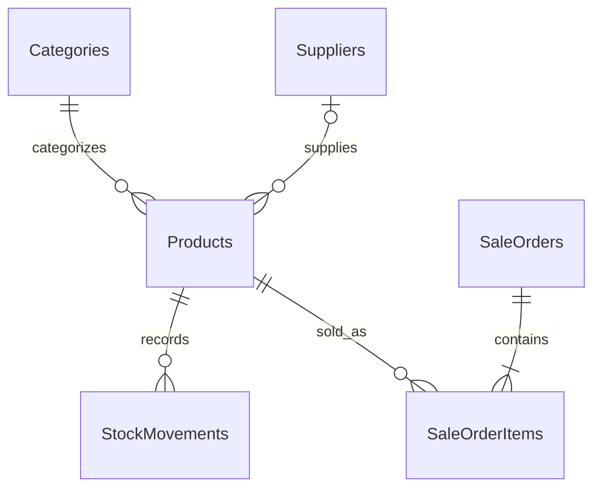

# SmartStore

Bộ khung backend quản lý cửa hàng bằng C# / ASP.NET Core Web API, Entity Framework Core và PostgreSQL.

## Công nghệ

- .NET SDK 10.0.401, target .NET 10.
- EF Core 10.0.12, Npgsql EF provider 10.0.3.
- PostgreSQL cài trực tiếp (16 trở lên; có thể dùng PostgreSQL 17).
- Controllers, request DTO validation, Problem Details, OpenAPI JSON và phân trang sản phẩm.
- GitHub Actions tự động build, kiểm thử và kiểm tra migration.

## Cấu trúc và kiến trúc

```text
src/
  SmartStore.Domain/          Entities và quy tắc tồn kho
  SmartStore.Application/     Request DTO và validation
  SmartStore.Infrastructure/  DbContext, mapping, EF migrations
  SmartStore.Api/             HTTP controllers, cấu hình, xử lý lỗi
tests/
  SmartStore.Tests/           Unit test, API test và PostgreSQL integration test
SmartStore.sln                Solution mở bằng Visual Studio
README.md                    Hướng dẫn và tài liệu dự án
```

Phụ thuộc hiện tại: API -> Infrastructure -> Application -> Domain. Domain không phụ thuộc EF hoặc HTTP. Application chứa request DTO có DataAnnotations. Infrastructure chịu trách nhiệm lưu trữ và migration; API điều phối các thao tác mẫu qua DbContext được inject theo scope request.

Đây là kiến trúc phân lớp khởi đầu. Khi nghiệp vụ mở rộng, định nghĩa use case/interface trong Application, chuyển điều phối khỏi controller, thêm response DTO và kiểm thử cho từng nghiệp vụ. EF Core cung cấp tracking và unit of work nên bộ khung chưa thêm generic repository.

## Chạy local (PowerShell)

Cài .NET 10 SDK và PostgreSQL trên máy, đảm bảo dịch vụ PostgreSQL đang chạy. Tạo user `smartstore` và database `smartstore` với user này làm owner bằng pgAdmin hoặc công cụ quản trị PostgreSQL. Bạn cũng có thể dùng user/database có sẵn và sửa connection string tương ứng.

```powershell
dotnet tool restore
dotnet restore

# Thay mật khẩu bằng mật khẩu PostgreSQL local; không commit connection string thật.
dotnet user-secrets set "ConnectionStrings:Store" "Host=localhost;Port=5432;Database=smartstore;Username=smartstore;Password=YOUR_LOCAL_PASSWORD" --project src/SmartStore.Api

# EF Core áp dụng toàn bộ migration để tạo/cập nhật các bảng.
dotnet ef database update --project src/SmartStore.Infrastructure --startup-project src/SmartStore.Api

dotnet run --project src/SmartStore.Api --launch-profile http
```

API: http://localhost:5080. OpenAPI JSON: http://localhost:5080/openapi/v1.json (Development). Chưa tích hợp Swagger UI.

Có thể thay user-secrets bằng biến môi trường `ConnectionStrings__Store`. Không tự động chạy migration khi API khởi động.

## API mẫu

| Method | Đường dẫn | Chức năng |
|---|---|---|
| GET, POST | /api/categories | Danh sách tối đa 200 / tạo danh mục |
| GET | /api/categories/{id} | Chi tiết danh mục |
| GET, POST | /api/suppliers | Danh sách tối đa 200 / tạo nhà cung cấp |
| GET | /api/suppliers/{id} | Chi tiết nhà cung cấp |
| GET, POST | /api/products | Phân trang / tạo sản phẩm |
| GET | /api/products/{id} | Chi tiết sản phẩm |
| POST | /api/products/{id}/stock-adjustments | Nhập / điều chỉnh tồn kho |
| GET | /api/products/{id}/stock-movements | 200 biến động mới nhất |
| POST | /api/sales | Tạo đơn bán và trừ kho |
| GET | /api/sales/{id} | Chi tiết đơn bán |
| GET | /health/live, /health/ready | Trạng thái API / kết nối database |

Có thể thử API bằng Postman. Tạo danh mục trước, sau đó dùng GUID trả về để tạo sản phẩm, nhập kho và bán hàng.

Tạo danh mục: `POST /api/categories`

```json
{ "name": "Đồ uống" }
```

Tạo sản phẩm: `POST /api/products`. Thay `CATEGORY_GUID` bằng GUID danh mục.

```json
{ "sku": "SP001", "name": "Cà phê", "price": 25000, "categoryId": "CATEGORY_GUID", "supplierId": null }
```

Nhập kho: `POST /api/products/PRODUCT_GUID/stock-adjustments`. Thay `PRODUCT_GUID` bằng GUID sản phẩm.

```json
{ "quantity": 100, "reason": "Nhập kho ban đầu" }
```

Tạo đơn bán: `POST /api/sales`.

```json
{ "items": [ { "productId": "PRODUCT_GUID", "quantity": 2 } ] }
```

## Database và EF Core migrations

Schema PostgreSQL là `public`. Tên bảng/cột giữ PascalCase. EF migrations trong `src/SmartStore.Infrastructure/Persistence/Migrations/` là nguồn quản lý schema; dùng `dotnet ef database update` để áp dụng.



| Bảng | Nội dung / ràng buộc |
|---|---|
| Categories | UUID PK, Name varchar(100) unique |
| Suppliers | UUID PK, Name, Email/Phone tùy chọn |
| Products | UUID PK, SKU unique, FK Category bắt buộc, Supplier tùy chọn; Price numeric(18,2) >= 0; Stock int >= 0 |
| StockMovements | UUID PK, FK Product, Quantity khác 0, Reason, CreatedAt UTC |
| SaleOrders | UUID PK, CreatedAt UTC |
| SaleOrderItems | UUID PK, FK SaleOrder/Product, Quantity > 0, UnitPrice numeric(18,2) >= 0 |

`Total` được tính từ dòng đơn, không lưu trong bảng. UUID và thời gian tạo do ứng dụng gán; ID được cấu hình `ValueGeneratedNever` để EF nhận đúng các bản ghi con mới. Không có seed tự động.

EF ánh xạ `Product.Version` (shadow property uint) sang cột hệ thống PostgreSQL `xmin` để kiểm soát cập nhật đồng thời. Một SaveChanges lưu cả đơn, dòng đơn, tồn kho và biến động trong cùng transaction. Nếu thất bại hoặc xung đột, toàn bộ thay đổi rollback.

Xóa bản ghi đang được tham chiếu bị chặn (Restrict). Quan hệ SaleOrder -> SaleOrderItems dùng cascade, nhưng API chưa cung cấp thao tác xóa đơn. Khi mở rộng, nên dùng quy trình hủy/trả hàng có lịch sử.

Sau khi thay đổi model/mapping, tạo migration mới rồi áp dụng:

```powershell
dotnet ef migrations add TenThayDoi --project src/SmartStore.Infrastructure --startup-project src/SmartStore.Api --output-dir Persistence/Migrations
dotnet ef database update --project src/SmartStore.Infrastructure --startup-project src/SmartStore.Api
```

Commit cả migration và model snapshot vào Git. Sao lưu database trước khi áp dụng migration trên môi trường có dữ liệu.

## Quy tắc nghiệp vụ

- Sản phẩm mới có tồn bằng 0; mọi thay đổi tồn qua `Product.AdjustStock` và ghi `StockMovement`.
- Không cho tồn âm, điều chỉnh bằng 0 hoặc lý do trống.
- SKU được trim và chuyển in hoa. Trùng SKU/danh mục trả 409; dữ liệu không hợp lệ trả 400.
- Đơn bán lấy giá từ database và lưu lại giá trên từng dòng; không nhận giá từ client. Không chấp nhận dòng sản phẩm trùng trong request.
- Khi xung đột tồn kho, API trả 409; client tải lại trạng thái trước khi thử lại.
- API chưa có idempotency key: không tự retry POST bán hàng khi timeout vì có thể tạo đơn trùng.
- Thời gian lưu UTC; frontend chuyển sang múi giờ hiển thị.
- Số tiền dùng decimal/numeric(18,2), đơn vị theo quy ước ứng dụng là VND. Cần thống nhất cách làm tròn khi bổ sung VAT/chiết khấu.
- OpenAPI chỉ bật ở Development. Readiness hiện kiểm tra kết nối database, chưa kiểm tra phiên bản migration.

## Build và kiểm thử

```powershell
dotnet build -c Release
dotnet test -c Release --filter "Category!=Integration"
dotnet ef migrations has-pending-model-changes --project src/SmartStore.Infrastructure --startup-project src/SmartStore.Api
```

Để chạy integration test, tạo database `smartstore_test` riêng với user `smartstore` làm owner. Test được phép tạo schema và thêm dữ liệu; không dùng database production.

```powershell
$env:ConnectionStrings__Store = "Host=localhost;Database=smartstore_test;Username=smartstore;Password=YOUR_LOCAL_PASSWORD"
dotnet test -c Release --filter "Category=Integration"
```

GitHub Actions dùng dịch vụ PostgreSQL cài trực tiếp trên runner Ubuntu 24.04, tạo database test riêng và chạy toàn bộ test. Tham khảo [cấu hình PostgreSQL trên GitHub runner](https://github.com/actions/runner-images/blob/main/images/ubuntu/Ubuntu2404-Readme.md#postgresql).

## Quy ước Git

Nhánh mặc định `main`; mỗi tính năng dùng nhánh `feature/ten-tinh-nang`. Commit nhỏ, rõ mục đích; tạo pull request và để CI chạy trước khi merge. Không commit user-secrets, credential hay bin/obj. Chưa bật branch protection tự động.

## Phạm vi và lộ trình

Chưa có đăng nhập/JWT, phân quyền, giao diện, thanh toán, trả hàng, sửa/xóa danh mục/sản phẩm, đơn nhập hàng hay quản lý nhiều chi nhánh. Cần bổ sung xác thực, phân quyền và HTTPS trước khi triển khai public API cho dữ liệu thực.

1. Xác thực và phân quyền Owner/Manager/Cashier; kiểm thử quyền truy cập.
2. CRUD hoàn chỉnh, lọc/tìm kiếm và phân trang tất cả danh sách.
3. Đơn nhập hàng, khách hàng, hủy/trả hàng và đối soát tồn kho.
4. Application services, response DTO, logging/audit và idempotency.
5. Kiểm thử migration/rollback, cập nhật kho đồng thời, deployment HTTPS và backup.

Repository public chỉ chứa mã và cấu hình mẫu. Chưa chọn giấy phép phân phối mã nguồn; chủ repository có thể bổ sung LICENSE phù hợp.
