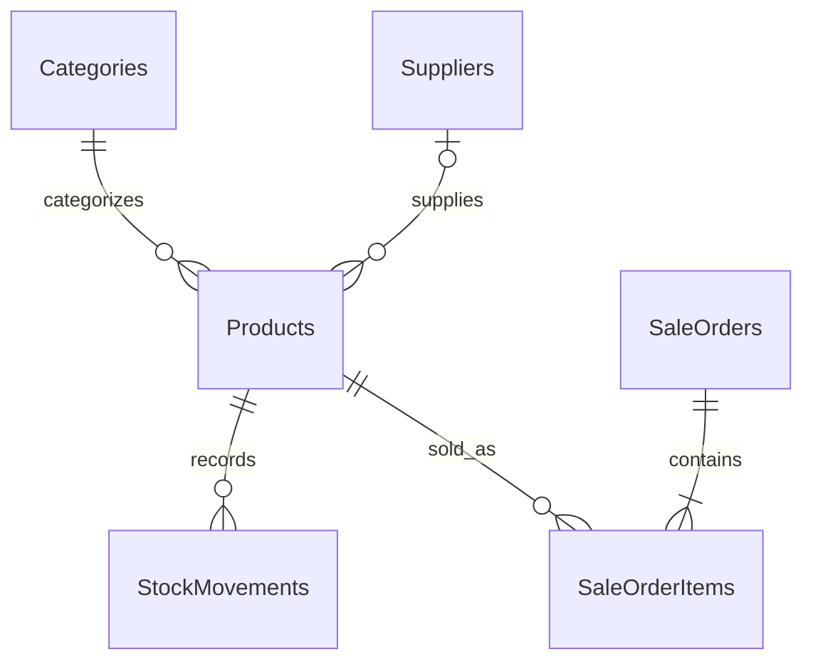

# Database SmartStore

PostgreSQL 17; schema public; các tên bảng/cột EF giữ PascalCase nên SQL cần dùng dấu ngoặc kép.



| Bảng | Nội dung / ràng buộc |
|---|---|
| Categories | UUID PK, Name varchar(100) unique |
| Suppliers | UUID PK, Name, Email/Phone tùy chọn |
| Products | UUID PK, SKU unique, FK Category bắt buộc, Supplier tùy chọn; Price numeric(18,2) >= 0; Stock int >= 0 |
| StockMovements | UUID PK, FK Product, Quantity khác 0, Reason, CreatedAt UTC |
| SaleOrders | UUID PK, CreatedAt UTC |
| SaleOrderItems | UUID PK, FK SaleOrder/Product, Quantity > 0, UnitPrice numeric(18,2) >= 0 |

`Total` được tính từ dòng đơn, không lưu trong bảng. UUID và thời gian tạo do ứng dụng gán. Không có seed tự động.

EF ánh xạ `Product.Version` (shadow property uint) sang cột hệ thống PostgreSQL `xmin` để kiểm soát cập nhật đồng thời. Một SaveChanges lưu cả đơn, dòng đơn, tồn kho và biến động trong cùng transaction. Nếu thất bại hoặc xung đột, toàn bộ thay đổi rollback.

Xóa các bản ghi đã được tham chiếu bị chặn (Restrict); xóa SaleOrder ở mức EF sẽ cascade các dòng đơn, nhưng API chưa cung cấp thao tác xóa đơn. Nên bổ sung quy trình hủy/trả hàng có lịch sử thay vì xóa dữ liệu bán hàng.

`initial.sql` được sinh bằng:

```powershell
dotnet ef migrations script --project src/SmartStore.Infrastructure --startup-project src/SmartStore.Api --output database/initial.sql
```

Áp dụng bằng `dotnet ef database update` như README chính, hoặc `psql -v ON_ERROR_STOP=1 -d CONNECTION_STRING -f database/initial.sql` trên database mới. Mật khẩu nên lấy từ môi trường; không ghi vào lệnh được chia sẻ.

Sau mỗi thay đổi schema, tạo migration mới. Sao lưu database trước khi áp dụng migration trên môi trường có dữ liệu. `docker compose down` giữ dữ liệu volume; tùy chọn `-v` xóa volume và toàn bộ dữ liệu local.
